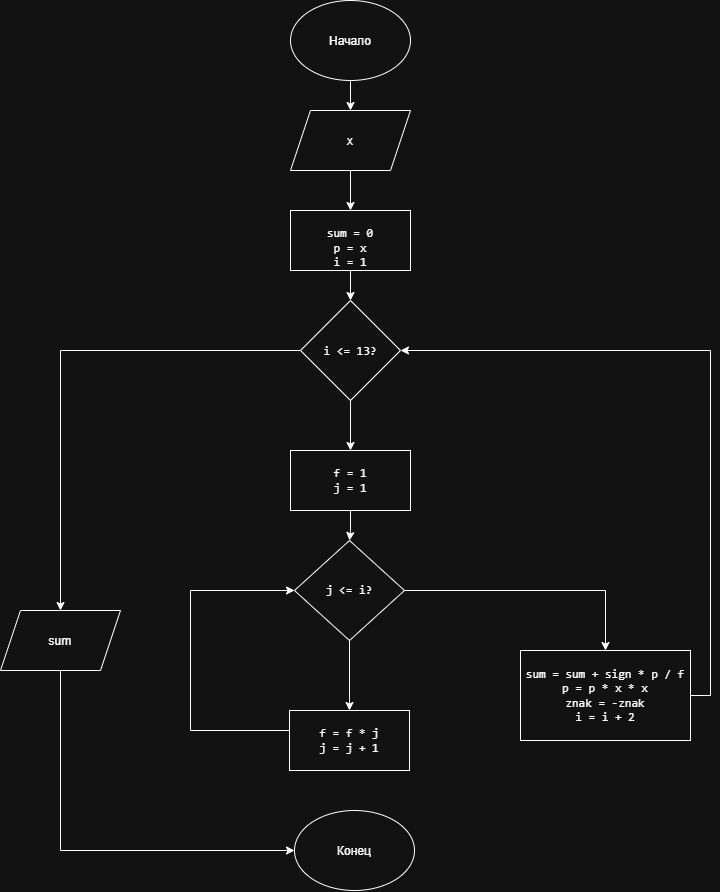

# Домашнее задание к лабораторной работе 8

## 7. Вычисление значения выражения

## Условие задачи

Задано значение `x`. Вычислить значение выражения:


S = x - x^3/3! + x^5/5! - x^7/7! + x^9/9! - x^11/11! + x^13/13!

где `x` — заданное пользователем число, а `!` обозначает факториал.

## 1. Алгоритм и блок-схема

### Алгоритм

1. **Начало**.
2. Ввести значение `x`.
3. Задать начальное значение суммы `S = 0`.
4. Задать начальное значение степени `p = x`.
5. Задать начальное значение факториала `f = 1`.
6. Для каждого нечётного числа `i` от `1` до `13` с шагом `2` выполнить:
   - Вычислить степень `x^i`.
   - Вычислить факториал `i!`.
   - Если номер слагаемого нечётный, прибавить слагаемое к сумме, если чётный — вычесть его.
7. Вывести значение суммы `S`.
8. **Конец**.

### Блок-схема

Блок-схема алгоритма должна содержать блок **«Повторение»** для организации цикла вычисления слагаемых.




## 2. Реализация программы

```cpp
#include <stdio.h>
#include <locale.h>

int main()
{
    setlocale(LC_ALL, "Russian");
    double x;
    double sum = 0;
    double p;
    double f = 1;
    int i;
    int j;
    int znak = 1;
    printf("Введите значение x: ");
    scanf("%lf", &x);
    p = x;
    for (i = 1; i <= 13; i = i + 2)
    {
        f = 1;
        for (j = 1; j <= i; j++)
        {
            f = f * j;
        }
        sum = sum + znak * p / f;
        p = p * x * x;
        sznak = -znak;
    }

    printf("Значение выражения: %.6f\n", sum);
    return 0;
}
```
## 3. Результаты работы программы

Пример работы программы при `x = 1`:

```text
Введите значение x: 1
Значение выражения: 0.841471
```

## 4. Информация о разработчике

**Фамилия:** Гусакова

**Имя:** Ксения

**Группа:** БИЦТ-261
